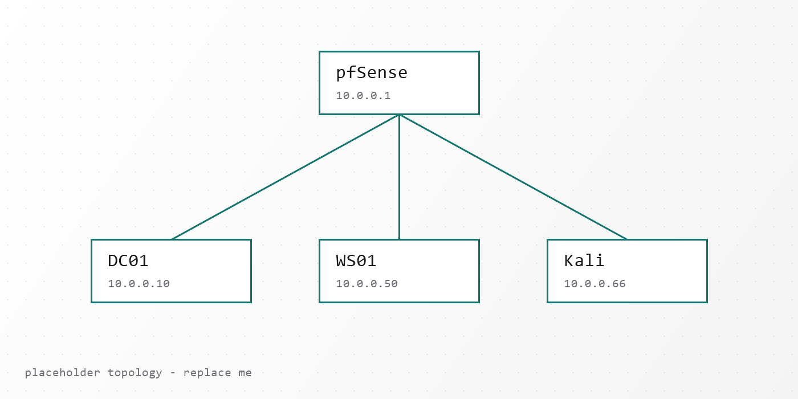

> **Placeholder.** Replace this body with the real writeup. It's here to show
> the whole flow: frontmatter → cover image → inline images → code blocks.

## Lab overview

Inline images use a plain relative path to this post's own `images/` folder.
Astro optimizes them at build time, just like `<Image />`:



## Promoting DC01

Code blocks get build-time syntax highlighting:

```powershell
Install-WindowsFeature AD-Domain-Services -IncludeManagementTools

Install-ADDSForest `
  -DomainName "lab.local" `
  -DomainNetbiosName "LAB" `
  -InstallDns `
  -SafeModeAdministratorPassword (Read-Host -AsSecureString "DSRM password")
```

## Next steps

- DNS and DHCP configuration
- Organizational units and service accounts
- Joining the first workstation
